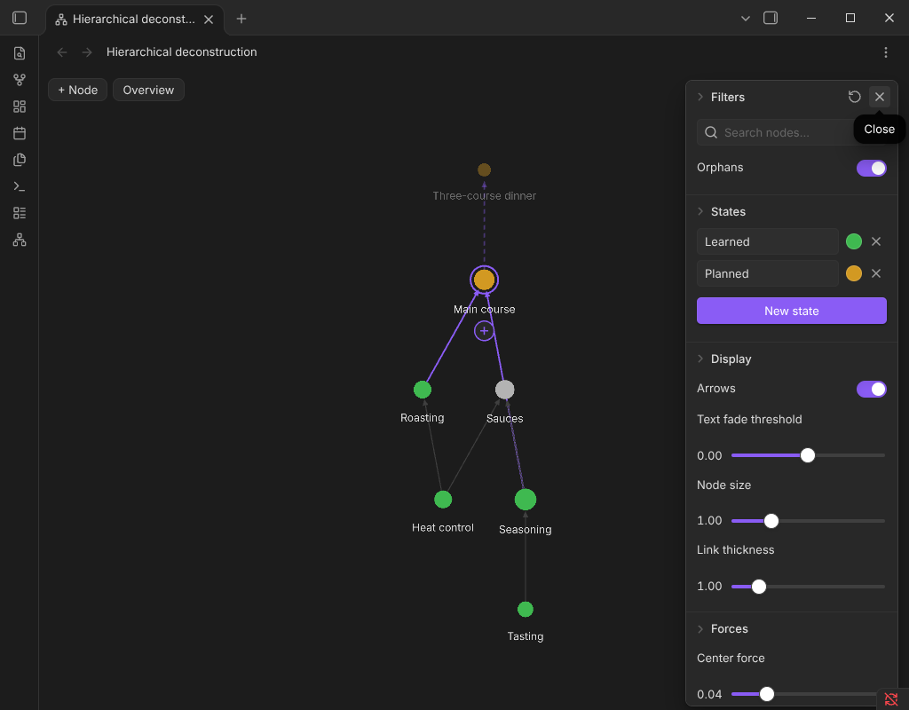

# Hierarchical deconstruction (HiDe)

Break any skill down into what it is built from — and see the whole tree at a glance.

## How it works

- Every skill is a note.
- Add what it is built from with **+** — pick an existing note or type a new name.
- Click a skill to see its full tree of foundations.
- Mark progress with colored states (for example *Learned*, *Planned*).

## Controls

- **+ Node** — new skill
- **Overview** — back to the whole graph
- **Double-click** — open the note
- **Gear** — filters, states, display and forces, just like the core graph

## Install

Settings → Community plugins → Browse → search **Hierarchical deconstruction**.

MIT license.
