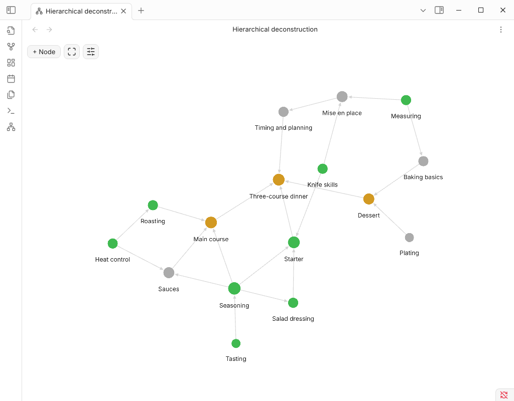
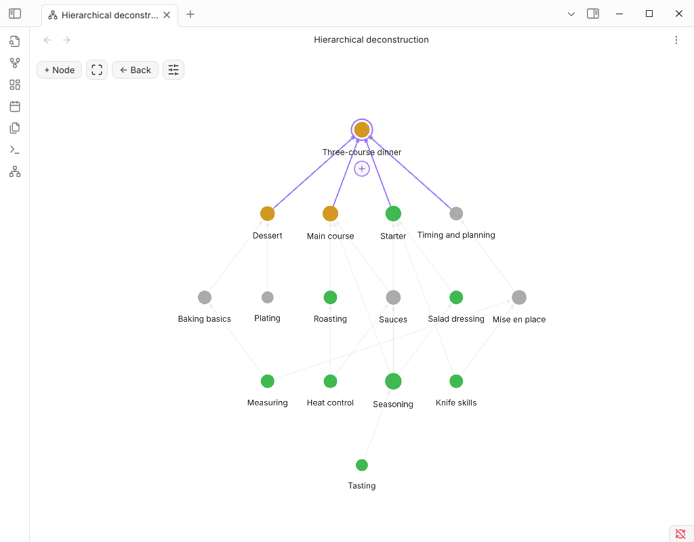

# HiDe — hierarchical deconstruction of skills

A graph where every skill is **built from its foundations**. Pick a skill and the camera zooms in: its foundations unfold beneath it, and faded "ghosts" above show what the skill is used for. Arrows point from foundation to skill.




## How data is stored

Everything is plain notes — the plugin keeps no database:

```yaml
---
requires: ["[[Empathy]]", "[[Sentence building]]"]   # what the skill is built from
state: done                                           # optional, sets the node color
---
```

`requires` are property links, so Obsidian's own graph, backlinks and rename-updates keep working. A skill is any note inside the plugin folder (default `Hierarchical deconstruction`) or any note with a `requires` property. Node positions, states and force settings live in the plugin's `data.json`.

## Features

- Graph view (ribbon icon or command *Open hierarchical deconstruction*): click = focus, double-click = open note, right-click = menu.
- The interface is English; it switches to Russian automatically when Obsidian is set to Russian.
- **+ Node** creates a new skill; the **+** under a selected node opens the same dialog and attaches the new node as a foundation of the selected one (an existing title is linked, not duplicated).
- Local graph of any note with adjustable depth.
- Editable states with colors; live force sliders (center, repel, link strength/distance, hierarchy pull, line width).
- Cycles are rejected: a skill can't be built from something built from it.

## Install (manual)

Copy `main.js`, `manifest.json`, `styles.css` into `<vault>/.obsidian/plugins/hide/` and enable the plugin.
